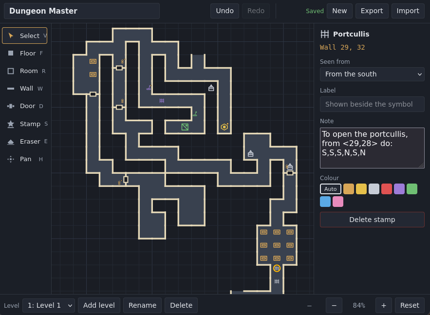

# Dungeon Mapper

A 100% vibe-coded project.

A grid-based mapping tool for classic first-person "blobber" dungeon crawlers
such as *Dungeon Master*, *Eye of the Beholder*, and *Lands of Lore*.

Draw rooms and corridors as you explore, mark the walls and doors you find, and
keep each dungeon floor on its own level.

## Using the editor

| Tool | Shortcut | What it does |
|---|---|---|
| Select | `V` | Click a square, wall, door or stamp to edit it in the properties panel |
| Floor | `F` | Paint explored squares. Drag to paint a run |
| Room | `R` | Drag out a rectangular room with walls around it |
| Wall | `W` | Draw walls along edges. Click an existing wall to remove it |
| Door | `D` | Place a door on an edge. Click an existing door to remove it |
| Stamp | `S` | Place symbols: keyholes, buttons, pits, stairs, notes and more |
| Eraser | `E` | Remove a stamp, wall, door, or floor square |
| Pan | `H` | Drag to move the map |

Also available:

- **Undo / redo** with `Ctrl+Z` and `Ctrl+Shift+Z`. A whole drag undoes in one step.
- **Pan** by holding `Space` with any tool, or dragging with the middle mouse button.
- **Zoom** with the mouse wheel, centred on the pointer.
- **Escape** clears the current selection.

## Saving

Your dungeon is **saved automatically** to the browser's local storage as you
draw, and reopens when you come back. The top bar shows the current save state.

Use **Export** to write the whole dungeon, including every level, to a
`.dungeon.json` file, and **Import** to open one again. Imported files are
validated, and a file that cannot be read is reported without disturbing the map
you already have open.

> **Back up your maps.** Browser storage is convenient but it is not a backup:
> clearing your browsing data will delete any dungeon stored there. Export to a
> file for anything you want to keep.

## Status

Phases 1 to 3 are complete:

- **Phase 1** — grid, pan and zoom, drawing tools, selection, undo/redo, and
  multiple levels.
- **Phase 2** — autosave to browser storage, restore on startup, and versioned
  JSON export/import.
- **Phase 3** — the stamp system: built-in catalogue, square and wall-face
  anchoring, labels and notes, cross-level links, and custom stamps.

Ideas for later:

- A library for managing several dungeons at once.
- PNG and print export, and a legend generated from the stamps in use.
- Search across labels and notes, filtered by stamp type.
- Marking secrets as found or still outstanding, and counting what remains.
